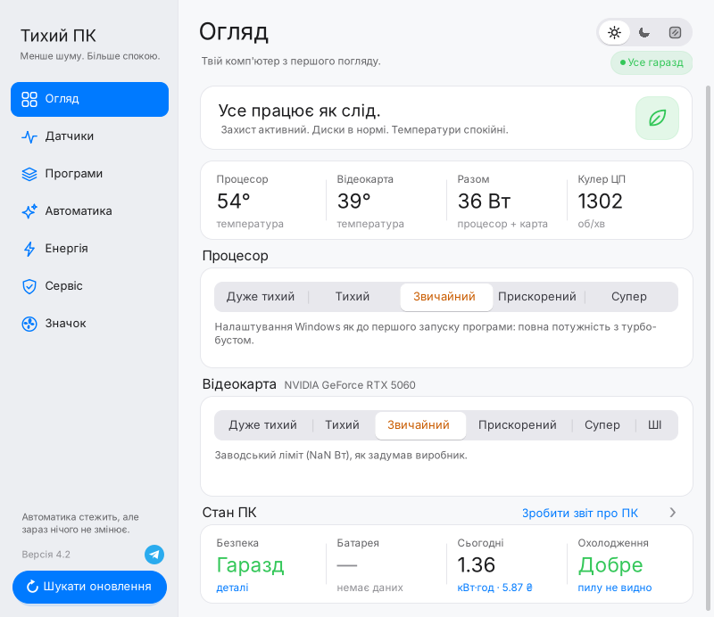
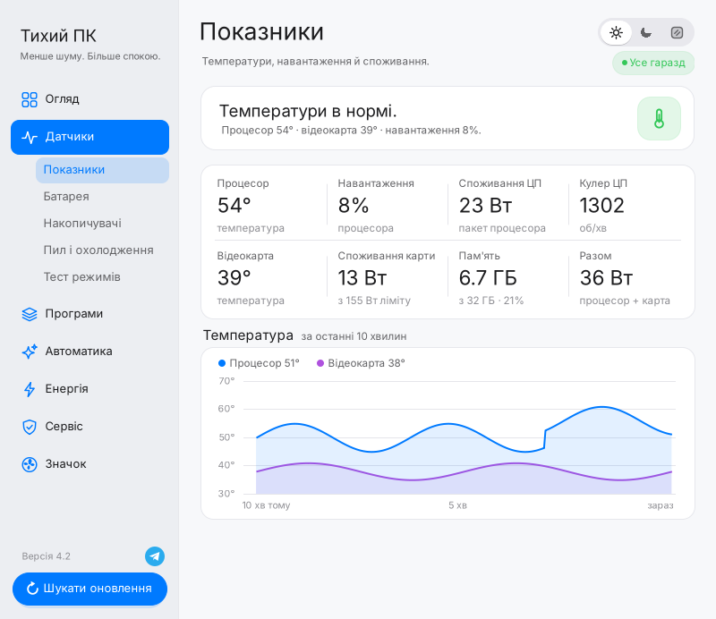
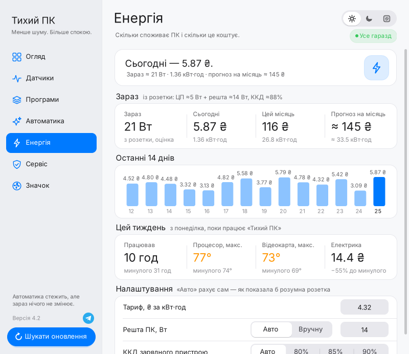
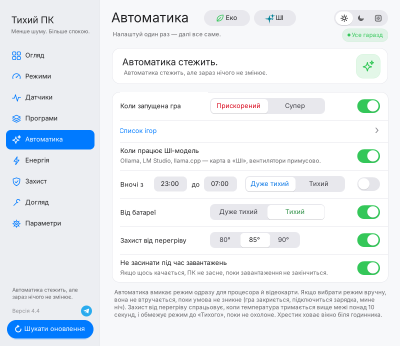
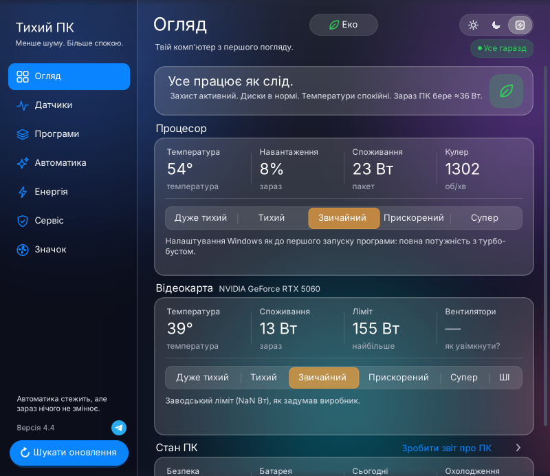

<div align="center">


# Тихий ПК

**Менше шуму. Більше спокою.**<br>
Одна кнопка — і процесор з відеокартою працюють тихіше й холодніше.<br>
А ще датчики, автоматика, підрахунок енергії, захист і сервіс — в одному гарному вікні українською.

[](https://github.com/Dimonchikk/TyhyiPK/actions/workflows/build.yml)
[](https://github.com/Dimonchikk/TyhyiPK/releases/latest)
[](LICENSE)
[](#встановлення)
[](#збирання)
[](src)
[](https://t.me/tyhyi_pk)

### [⬇️ Завантажити останній реліз](https://github.com/Dimonchikk/TyhyiPK/releases/latest/download/Tykhyi-PK-setup.exe) · [Встановлення](#встановлення) · [Збирання](#збирання) · [Сайт](https://dimonchikk.github.io/TyhyiPK/) · [Telegram](https://t.me/tyhyi_pk)

<br>

<picture>
  <source media="(prefers-color-scheme: dark)" srcset="screenshots/home-dark.png">
  
</picture>

</div>

---

## Можливості

| | |
|---|---|
| 🌀 **Режими** | «Дуже тихий», «Тихий», «Звичайний», «Прискорений», «Супер» — окремо для процесора й відеокарти. Для карти ще «ШІ»: ліміт 90% і примусові вентилятори під локальні моделі. |
| 🌡️ **Датчики** | Температури, навантаження, споживання, оберти кулерів, батарея, диски й графік за 10 хвилин. |
| 🤖 **Автоматика** | Сама вмикає потрібний режим для ігор, ШІ-моделей (Ollama, LM Studio), ночі, батареї й перегріву. |
| ⚡ **Енергія** | Скільки ПК бере з розетки і скільки це коштує в гривнях — за день, тиждень і місяць. |
| 🛡️ **Сервіс** | Перевірка Defender, пошук майнерів, мережа, очищення диска, тест швидкості інтернету, оновлення Windows. |
| 🎨 **Вигляд** | Світла, темна й прозора тема «Скло», вікно на весь екран у дві колонки, живий вентилятор біля годинника. |
| 🔔 **Оновлення** | Програма сама перевіряє нові версії на GitHub, а новини виходять у [Telegram-каналі](https://t.me/tyhyi_pk). |

<div align="center">

| Показники | Енергія |
|:---:|:---:|
| <picture><source media="(prefers-color-scheme: dark)" srcset="screenshots/sens-dark.png"></picture> | <picture><source media="(prefers-color-scheme: dark)" srcset="screenshots/energy-dark.png"></picture> |
| **Автоматика** | **Тема «Скло»** |
| <picture><source media="(prefers-color-scheme: dark)" srcset="screenshots/rules-dark.png"></picture> |  |

</div>

## Встановлення

1. Завантаж **[Tykhyi-PK-setup.exe](https://github.com/Dimonchikk/TyhyiPK/releases/latest/download/Tykhyi-PK-setup.exe)** з останнього релізу.
2. Запусти його. Програма встановиться в `%LOCALAPPDATA%\Programs\TyhyiPK` і створить ярлик на робочому столі.
3. Якщо з'явиться синє вікно **«Windows захистила ваш ПК»** — натисни **«Докладніше» → «Все одно виконати»**. Це звичайна перевірка SmartScreen для програм без платного підпису.
4. Щоб бачити температуру й споживання процесора, встанови драйвер **[PawnIO](https://pawnio.eu/)** — програма запропонує це наприкінці. Без нього все інше працює.

Потрібна Windows 10 або 11. .NET Framework 4 уже є в системі — нічого додатково встановлювати не треба.

## Збирання

Програма збирається стандартним компілятором `csc.exe` з .NET Framework — без Visual Studio.

```powershell
git clone https://github.com/Dimonchikk/TyhyiPK.git
cd TyhyiPK
./src/build.ps1
```

Готові `TyhyiPK.exe` і `Tykhyi-PK-setup.exe` з'являться в папці `src`. Бібліотеку датчиків LibreHardwareMonitor скрипт завантажує сам і вшиває в exe.

**Релізи** збирає GitHub Actions ([build.yml](.github/workflows/build.yml)): запуск з номером версії → збирання на Windows → чернетка релізу з описом із [CHANGES.md](CHANGES.md). Після публікації бот сам пише допис у Telegram-канал.

## Як влаштовано

- **Мова й платформа:** C# 5, .NET Framework 4, Windows Forms, AnyCPU.
- **Інтерфейс:** власні елементи (бокове меню, картки, перемикачі, графіки) намальовані вручну — у [`src/Shell.cs`](src/Shell.cs), [`src/Controls.cs`](src/Controls.cs), [`src/Ui.cs`](src/Ui.cs).
- **Режими:** процесор — через плани живлення Windows ([`src/Core.cs`](src/Core.cs)), відеокарта — ліміт потужності через `nvidia-smi` ([`src/Gpu.cs`](src/Gpu.cs)).
- **Датчики:** [LibreHardwareMonitor](https://github.com/LibreHardwareMonitor/LibreHardwareMonitor) + драйвер [PawnIO](https://pawnio.eu/) ([`src/Lhm.cs`](src/Lhm.cs)).
- **Історія змін:** [CHANGES.md](CHANGES.md).

## Ліцензія

[MIT](LICENSE) © Дмитро Бричнік. LibreHardwareMonitor поширюється за ліцензією MPL 2.0.

<div align="center"><sub>Зроблено в Україні 🇺🇦</sub></div>
